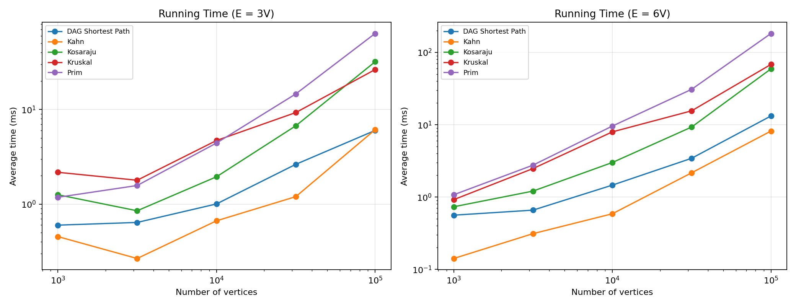
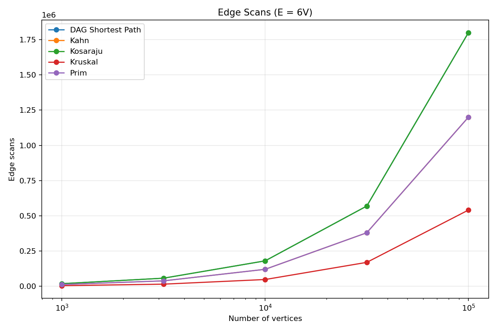
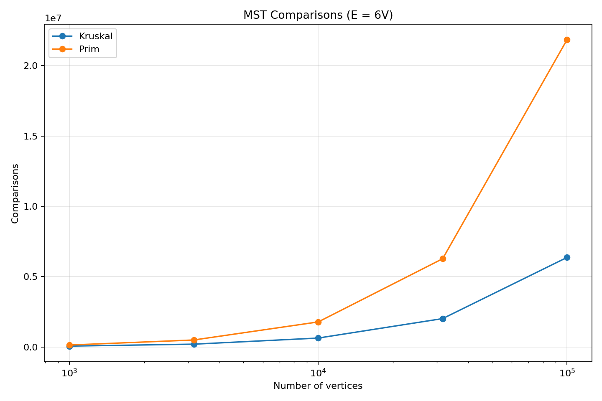

# Assignment 3 Report
## Graph Algorithms: DSU, MST, SCC and Shortest Paths

**Student:** Amina Satybaldy  
**Group:** SE-2517  
**Course:** Design and Analysis of Algorithms

## 1. Introduction

The goal of this assignment was to implement and compare different graph algorithms in Java. I worked with directed and undirected weighted graphs.

I implemented Disjoint Set Union, Kruskal, Prim, Kosaraju, Kahn, and DAG Shortest Paths. I also wrote tests and created a benchmark to compare running time and operation counts.

The main idea was to understand how the algorithms work and how their performance changes when the graph becomes larger.

## 2. Implementation

### 2.1 Graph Representation

I used an adjacency list to store the graph. Each vertex has a list of its outgoing edges.

An edge contains three values: the starting vertex, the destination vertex, and the weight.

For undirected graphs, an edge is stored in both directions. For directed graphs, it is stored only in one direction.

The adjacency list uses O(V + E) memory, where V is the number of vertices and E is the number of edges.

### 2.2 Disjoint Set Union

DSU helps to check whether two vertices belong to the same connected component.

I implemented two optimizations:

- Path compression makes future `find()` operations faster.
- Union by rank keeps the trees relatively small.

These optimizations make DSU operations very fast. Their amortized time complexity is O(α(V)), which is almost constant in practice.

### 2.3 Minimum Spanning Tree

I implemented Kruskal and Prim.

Kruskal sorts edges by weight. Then it takes the smallest edges that do not create a cycle. It uses DSU to check this.

Prim starts from one vertex and grows the tree. It uses a priority queue to select the smallest available edge.

Both algorithms find a minimum spanning tree for a connected undirected graph. For a disconnected graph, my implementations return a minimum spanning forest.

For example, in `connected.txt`, the minimum spanning tree uses edges with weights 1, 2, and 3. The total weight is 6.

### 2.4 Strongly Connected Components

I used Kosaraju's algorithm to find strongly connected components in directed graphs.

The algorithm has two main DFS passes. The first pass finds the finishing order. Then the graph is reversed. The second pass finds the components.

I used iterative DFS instead of recursive DFS. This is useful for large graphs because deep recursion may cause a stack overflow.

### 2.5 Topological Sorting

I implemented Kahn's algorithm.

First, the algorithm calculates the indegree of each vertex. Vertices with indegree zero are added to a queue.

When a vertex is removed from the queue, its outgoing edges are processed. If another vertex gets indegree zero, it is also added to the queue.

If the algorithm cannot process all vertices, the graph contains a directed cycle.

### 2.6 DAG Shortest Paths

For shortest paths, I used topological ordering.

The algorithm processes vertices in topological order and relaxes their outgoing edges. This makes it possible to find shortest paths in O(V + E) time.

It also supports negative edge weights because a directed acyclic graph has no directed cycles.

For example, in `dag.txt`, the shortest distance from vertex 0 to vertex 5 is 5:

0 → 2 → 4 → 5

The total weight is 3 + 4 - 2 = 5.

## 3. Complexity Analysis

| Algorithm | Time Complexity | Space Complexity |
|---|---|---|
| DSU | O(α(V)) amortized per operation | O(V) |
| Kruskal | O(E log E + E α(V)) | O(V + E) |
| Prim with priority queue | O(E log E) | O(V + E) |
| Kosaraju | O(V + E) | O(V + E) |
| Kahn | O(V + E) | O(V + E) |
| DAG Shortest Paths | O(V + E) | O(V + E) |

Kruskal needs to sort edges, so sorting is an important part of its complexity.

Prim uses a priority queue. In my implementation, edges are added to the queue, and queue operations take logarithmic time.

Kosaraju, Kahn, and DAG Shortest Paths mainly process vertices and edges. Their theoretical time complexity is linear in V + E.

## 4. Testing

I used JUnit 5 to test the algorithms.

The tests cover normal cases and special cases, including:

- Connected and disconnected graphs
- Single vertices
- Graphs with cycles
- Equal edge weights
- Negative edge weights in DAGs
- Unreachable vertices
- Large graphs
- Randomly generated graphs

I also compared the MST results from Kruskal and Prim. They should have the same total weight for a connected undirected graph.

Randomized tests are useful because they check more situations than one manually created example.

## 5. Benchmark Methodology

I created a benchmark to measure the performance of five algorithms:

Kruskal, Prim, Kosaraju, Kahn, and DAG Shortest Paths.

I used the following graph sizes:

- 1,000 vertices
- 3,162 vertices
- 10,000 vertices
- 31,623 vertices
- 100,000 vertices

For each graph size, I used two edge densities:

- E = 3V
- E = 6V

Every experiment was repeated five times. I calculated the average execution time in milliseconds.

The random graph generator uses seed 42. This helps to reproduce the same input graphs.

The benchmark also records these metrics:

- **DSU operations:** Work done by DSU during the algorithm.
- **Edge scans:** Number of edge-processing operations.
- **Comparisons:** Selected comparisons performed by the algorithms.
- **Maximum depth:** Maximum recorded DFS stack depth or DSU depth.

These counters measure different parts of the implementation. They are useful for studying how the amount of work grows, but they do not represent every executed CPU instruction.

The benchmark output is saved in `results/results.csv`.

## 6. Experimental Results

### 6.1 Running Time

Figure 1 shows the average running time for different graph sizes and edge densities.

In general, all algorithms need more time when the graph becomes larger.

The graph also shows that increasing the number of edges can increase running time.

Prim has a relatively high running time on the largest tested graphs. This can happen because the priority queue must manage many edges.

Kahn and DAG Shortest Paths are generally faster in these experiments. Their algorithms have linear theoretical complexity.

There are small differences and fluctuations for smaller graphs. This is normal because execution time can be affected by JVM warm-up, garbage collection, and other work on the computer.

### 6.2 Edge Scans

Figure 2 shows how the number of edge scans changes when the graph becomes larger.

The number of scans increases with graph size.

Kosaraju performs several passes over the graph, including work with reversed edges. Because of this, its edge scan counter can be higher.

Prim processes adjacency lists while building the spanning tree.

Some lines overlap because different algorithms may have similar or identical scan counts for the generated graphs.

This graph helps explain the difference between theoretical complexity and actual counted operations.

### 6.3 MST Comparisons

Figure 3 compares the number of recorded comparisons in Kruskal and Prim.

Both algorithms perform more comparisons on larger graphs.

Kruskal compares edge weights when sorting edges.

Prim compares edges while working with its priority queue.

In my benchmark, Prim performs more recorded comparisons than Kruskal on large graphs.

This does not mean that Kruskal is always better. The result depends on the graph, data structures, and implementation.

## 7. Discussion

The benchmark results are generally consistent with the theoretical analysis.

Algorithms with O(V + E) complexity show growth related to the number of vertices and edges.

For Kruskal and Prim, sorting and priority queue operations add logarithmic work.

The comparison counters are not completely identical across algorithms. Each algorithm counts operations related to its own implementation. For this reason, I use the counters to study trends, not as a universal measure of algorithm speed.

The benchmark also has some limitations. I measured the programs on one computer, and I used randomly generated graphs. Different computers and graph structures may produce different running times.

## 8. Which Algorithm Would I Choose?

For building a minimum-cost road network, I would choose Kruskal or Prim because both find minimum spanning trees.

Kruskal is a good choice when I already have a list of weighted edges. Prim is useful when I want to grow a tree from a starting vertex.

For finding groups of mutually reachable vertices in a directed graph, I would choose Kosaraju.

For ordering jobs with dependencies, I would choose Kahn. It can also show whether the dependencies contain a cycle.

For shortest paths in a DAG, I would choose DAG Shortest Paths. It is efficient and supports negative edge weights.

## 9. Conclusion

In this assignment, I learned how different graph algorithms solve different problems.

I implemented the algorithms in Java, tested their behavior, and measured their performance on graphs of different sizes.

The experiments showed that running time and operation counts usually increase as the graph becomes larger.

I also learned that theoretical complexity is important, but practical performance depends on the implementation and the input graph.

Overall, this assignment helped me understand graph algorithms, testing, and performance analysis better.